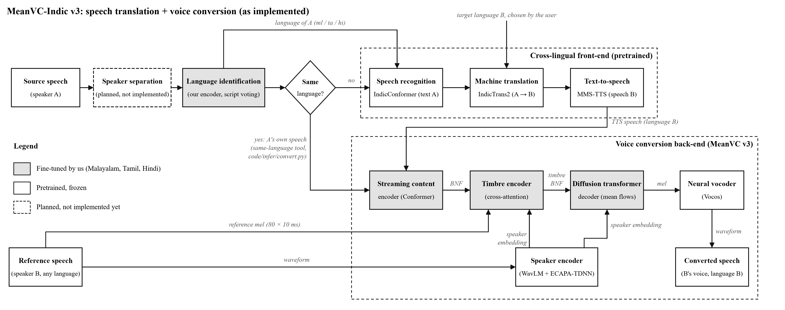

# MeanVC-Indic v3: the complete system

**Project:** A Voice Conversion Framework for Overlapping Speakers and Cross-Lingual Speech
**Authors:** Mathew J Shaji, · **Guide:** Ms. Remya M S
**Amrita School of Computing, Amritapuri**

This document describes the whole system in one place: the architecture, what every folder and file does
(from fine-tuning to conversion), the metrics used, the results, how the models were trained, and how to
run everything.

| Section | Contents |
|---|---|
| 1 | Architecture: the diagram and every module in detail |
| 2 | Folders and files, from fine-tuning to conversion |
| 3 | Metrics |
| 4 | Results after translation + conversion |
| 5 | Results of voice conversion without translation (Stage 5) |
| 6 | Training details |
| 7 | How to run, and where to listen |
| 8 | Requirements |
| 9 | Credits and licences |

| Other documents | Contents |
|---|---|
| [data/README.md](data/README.md) | The dataset: source link, the part used, and the splits |
| [code/translate/README.md](code/translate/README.md) | The translation pipeline: options, outputs and set-up |
| [outputs/eval_v3/README.md](outputs/eval_v3/README.md) | Stage 5 results (voice conversion only) and their audio examples |
| [outputs/stage6_speech_translation_voice_conversion_results/README.md](outputs/stage6_speech_translation_voice_conversion_results/README.md) | Stage 6 results (translation + conversion), audio examples and figures |
| [outputs/results_comparison_before_and_after_translation/README.md](outputs/results_comparison_before_and_after_translation/README.md) | Stage 5 vs Stage 6 |
| [docs/architecture_modules.txt](docs/architecture_modules.txt) | Every module: input, process, output, model and code |

---

## 1. Architecture

### 1.1 The system diagram


**Checked against the code.** The diagram is correct, apart from the points below:

| # | In the diagram | In the implemented system |
|---|---|---|
| 1 | **Speaker separation (overlapping speech)** | **Not implemented yet.** No code separates overlapping speakers. The input must be speech from one speaker. This block is planned work. |
| 2 | "Same language?" decision with no language detection before it | The decision needs **language identification**, done by our fine-tuned content encoder (script voting, 99.3 % correct). It also tells the speech recogniser which language to use. |
| 3 | "yes" path straight to voice conversion | Correct, but it is a **separate tool**: `code/infer/convert.py` (same-language conversion). The translation tool `code/translate/speech_translator.py` always translates, and refuses a target language equal to the source. |
| 4 | Speaker embedding goes only to the DiT | It goes to **both the timbre encoder and the DiT**. In the code, `MRTE(cond, prompts, spks)` joins (concatenates) the projected speaker embedding to the attention keys. |
| 5 | Reference speech "(language B)" | B can speak **any** of the three languages. In our tests B speaks the target language. |

### 1.2 Corrected diagram (the system as implemented)



The same diagram as text (drawn by `docs/draw_architecture.py`):

```
 SOURCE: speaker A, one speaker,               REFERENCE: speaker B (any of ml / ta / hi)
 Malayalam / Tamil / Hindi                              │                     │
        │                                                │ waveform            │ waveform
        ▼                                                │                     │
 [ Speaker separation ]  ← planned, NOT implemented      │                     │
        │                                                │                     │
        ▼                                                │                     │
 ┌──────────────────────┐                                │                     │
 │ Language ID (ours)   │  our fine-tuned encoder +      │                     │
 │ script voting        │  CTC head ─► "ml"/"ta"/"hi"    │                     │
 └──────────┬───────────┘                                │                     │
            ▼                                            │                     │
     Same language as target?                            │                     │
      │ yes                │ no                          │                     │
      │ (convert.py)       ▼                             │                     │
      │   ┌──────────────── CROSS-LINGUAL FRONT-END (pretrained, frozen) ───┐  │
      │   │ Speech recognition ─► Machine translation ─► Text-to-speech     │  │
      │   │ IndicConformer 600M   IndicTrans2 320M       MMS-TTS (VITS)     │  │
      │   │ speech ─► text (A)    text A ─► text B        text B ─► speech  │  │
      │   └──────────────────────────────────────────────────────┬──────────┘  │
      │ A's real speech                                          │ TTS speech  │
      ▼                                                          ▼             │
 ┌───────────────────────── VOICE CONVERSION BACK-END (MeanVC v3) ───────────────────────────┐
 │                                                                                           │
 │  ■ Streaming content encoder ─BNF─► ■ Timbre encoder ─timbre BNF─► ■ DiT decoder ─mel─►  Vocoder ─► CONVERTED SPEECH
 │    (Conformer, fine-tuned)            (cross-attention,              (mean flows,     (Vocos,    (B's voice)
 │                                        fine-tuned)                    fine-tuned)      frozen)
 │                                          ▲          ▲                   ▲              │
 │              reference mel (80 × 10 ms) ─┘          │                   │              │
 │                                                     │ speaker embedding │              │
 │  B's waveform ─► Speaker encoder (WavLM-Large + ECAPA-TDNN, frozen) ────┴──────────────┤
 └───────────────────────────────────────────────────────────────────────────────────────────┘
 ■ = fine-tuned by us on Malayalam, Tamil, Hindi     unmarked = pretrained, frozen
```

### 1.3 Each module in detail

Running example for every module: speaker A says a **5-second Malayalam sentence**, the user chooses
**Tamil**, and a recording of **speaker B** gives the voice. The sizes in brackets are for that example.

```
A's speech ─► [1] load ─► [2] separation (planned) ─► [3] language ID ─► [4] same language?
   no ─► [5] speech recognition ─► [6] translation ─► [7] text-to-speech ─► [8] content encoder
   yes ─────────────────────────────────────────────────────────────────► [8] content encoder
B's speech ─► [9] load ─► [10] reference mel + [11] speaker encoder
[8] + [10] + [11] ─► [12] timbre encoder ─► [13] DiT decoder ─► [14] vocoder ─► [15] converted speech
```

#### [1] Source speech (speaker A)

**Type:** input. **Code:** `load_wav()` in `code/infer/convert.py`.

**Input:** a recording of speaker A in Malayalam, Tamil or Hindi, in any format the `soundfile`
library reads (wav, flac, …), at any sample rate, mono or stereo. 3–15 s works best.

**What happens:**

1. The file is read as floating-point samples.
2. **Stereo becomes mono** by averaging the two channels.
3. **Resampling to 16,000 samples per second** with a polyphase filter (`scipy.signal.resample_poly`).
   All models in the system were trained on 16 kHz audio, so every input must have this rate.
4. Values are **clipped to −1 … +1**, so that a few overloud samples cannot break later steps.

**Output:** the waveform: 16,000 numbers per second (80,000 for 5 s). It goes to [3], and, on the
same-language path, to [8].

**Note:** the input must contain **one** speaker. Overlapping voices are not handled yet (see [2]).

#### [2] Speaker separation (overlapping speech)

**Type:** planned, **not implemented**.

**Idea:** when two people talk at the same time, a separation model would split the mixture into one
track per speaker, and the chosen speaker's track would continue through the system. **No code for this
exists yet.** Today the waveform from [1] goes straight to [3].

#### [3] Language identification

**Type:** fine-tuned by us (the Stage 2 encoder). **Model:** `checkpoints/encoder_v3/best.pt`.
**Code:** `Recognizer`, `identify_language()` in `code/translate/speech_translator.py`.

**Input:** speaker A's waveform (16 kHz).

**What happens:**

1. **Features:** the same fbank + Conformer encoder as module [8] (explained in detail there) turns the
   speech into one feature vector every 40 ms (125 frames).
2. **CTC head:** a final layer gives, for every 40 ms frame, a probability for each of the **174
   tokens** of our vocabulary: Malayalam, Tamil and Devanagari letters, the space `▁`, an "unknown"
   token, and a special **blank** token that means "no new letter here".
3. **Greedy decoding:** for each frame the most likely token is taken. Then repeated tokens are merged
   and blanks removed. For example `ക ക ‹blank› ര ര` becomes `കര`. The result is a rough
   transcript (about 25 % of letters wrong, which is fine for this purpose).
4. **Script voting:** Malayalam, Tamil and Hindi use **three different alphabets**. Every letter's
   Unicode name says which one it belongs to (`MALAYALAM LETTER KA`, `TAMIL LETTER KA`,
   `DEVANAGARI LETTER KA`). The letters are counted per script, e.g. Malayalam 41, Tamil 1, Hindi 0.
5. **Decision:** the script with the most letters is the language. Its share is the **confidence**
   (41 / 42 = 98 %). Below 60 %, the command line asks the user to confirm.

**Output:** the language code (`ml` / `ta` / `hi`), the confidence and the letter counts. It goes to [4],
and to [5] (IndicConformer must be told the language). It also decides the target menu: only the two
other languages are offered.

**Why this method:** it needs no extra model, it reuses our own encoder, it takes 0.05 s, and because the
three scripts are completely different, even a rough transcript points clearly to one language.
**Result:** 99.3 % correct on 300 test clips (Malayalam 100 %, Tamil 100 %, Hindi 98 %).

#### [4] Same language? (decision)

**Type:** program logic. **Code:** `choose_targets()` in `speech_translator.py`.

**Input:** the source language from [3] and the target language B chosen by the user (`--target ml/ta/hi/all`,
or a menu that lists only the two other languages).

**What happens:** the two are compared.

- **Different languages (no):** the sentence must be translated, so the speech goes to [5] → [6] → [7] → [8].
- **Same language (yes):** nothing to translate. Speaker A's own speech goes directly to [8], and the
  result is A's sentence in B's voice, in the same language. This path is the separate same-language tool
  `code/infer/convert.py`. The translation tool refuses a target equal to the source and asks for
  another language.

#### [5] Speech recognition (speech → text)

**Type:** pretrained, frozen. **Model:** AI4Bharat IndicConformer 600M multilingual
(`ai4bharat/indic-conformer-600m-multilingual`, ONNX files in `D:\hf_cache`).
**Code:** `IndicConformerRecognizer`, `keep_script()` in `speech_translator.py`. **Runs on:** the CPU.

**Input:** speaker A's waveform + the language code from [3].

**What happens:**

1. **Preprocessing:** the audio is turned into a spectral picture of the sound (frequency against time),
   like the fbank in [8].
2. **Conformer encoder:** a large Conformer network (600 million parameters, trained on thousands of
   hours of IndicVoices speech) turns the spectral frames into acoustic representations: what sound is
   being made at each moment, using the whole sentence as context.
3. **RNNT decoding**, which writes the text letter by letter:
   - a **prediction network** (an LSTM with 2 layers of 640 units) remembers the letters written so far;
   - a **joint network** combines that memory with the current audio frame;
   - a **language-specific output layer** (here: Malayalam) chooses the next letter, or "blank", which
     means move on to the next audio frame. Up to 10 letters can come from one frame.
   Because each letter depends on the previous ones, RNNT spells more consistently than plain CTC.
4. The word separator `▁` becomes a space.
5. **`keep_script()` clean-up:** if a few letters came out in another Indian script, they are
   transliterated into the source script (the scripts map letter by letter). An invalid virama after a
   Malayalam chillu letter is removed.

**Output:** the transcript, a sentence in language A. It goes to [6].

**Why IndicConformer:** it was trained on IndicVoices, the same kind of spontaneous speech as our data.
On our 300 test clips it gets **7.3 % of characters wrong**, against 26.2 % for our own encoder and 24.1 %
for Meta MMS-1b-all. Better text going in means a better translation coming out (chrF 37.2 → 64.7).
**Caveat:** IndicConformer was trained on IndicVoices, the source of IndicVoices-R. We have not confirmed
that its training excluded our test speakers, so its score may be optimistic.

#### [6] Machine translation (text A → text B)

**Type:** pretrained, frozen. **Model:** AI4Bharat IndicTrans2 Indic↔Indic, distilled, 320M
(`ai4bharat/indictrans2-indic-indic-dist-320M`). **Code:** `Translator` in `speech_translator.py`,
`IndicProcessor` in `code/translate/indic_processor.py`. **Runs on:** the GPU.

**Input:** the text in language A, the source code and the target code (e.g. `mal_Mlym` → `tam_Taml`).

**What happens:**

1. **Pre-processing (IndicProcessor):**
   - punctuation is normalised, and Indian-script digits become 0–9;
   - numbers, e-mails and web addresses are replaced by placeholders (`<ID1>`, …), so they are copied
     unchanged instead of being "translated";
   - Indian-language normalisation and splitting into words;
   - **script unification:** Malayalam and Tamil letters are transliterated into **Devanagari**. IndicTrans2
     handles all Indian languages in one shared script, so the same sound is written the same way in
     every language and the model can share what it learned;
   - two **language tags** go in front: `mal_Mlym tam_Taml <sentence>` (from Malayalam, to Tamil).
2. **Tokenisation:** the text is cut into **subword pieces** (common word parts), each with an id number.
3. **Transformer encoder:** reads the whole source sentence and builds a representation of its meaning.
4. **Transformer decoder with beam search (5 beams):** writes the translation piece by piece. At each
   step it looks at the source (cross-attention) and at what it has written. Beam search keeps the
   **5 most likely partial translations** at every step and finally picks the best complete one.
   Two safety limits: the output may be at most about **twice as long as the input**, and **no 4-piece
   sequence may repeat**. Without them, noisy input sometimes made the model repeat one word endlessly.
5. **Post-processing (IndicProcessor):** placeholders are put back, the Devanagari is transliterated into
   the **target script** (Tamil), and the pieces are joined into normal text.

**Output:** the translated sentence in language B. It goes to [7].

**Why IndicTrans2:** it translates **directly between Indian languages** (Malayalam ↔ Tamil ↔ Hindi),
without going through English, which would lose meaning twice.

#### [7] Text-to-speech (text → speech)

**Type:** pretrained, frozen. **Model:** Meta MMS-TTS, one model per language (`facebook/mms-tts-mal`,
`-tam`, `-hin`). **Code:** `Synthesizer` in `speech_translator.py`. **Runs on:** the GPU.

**Input:** the translated sentence in language B.

**What happens (VITS, an end-to-end text-to-speech model):**

1. **Tokenisation:** each character becomes an id. Characters the voice does not know are dropped.
2. **Text encoder** (a transformer): reads the characters and builds a representation of how each one
   should sound in context.
3. **Duration predictor:** decides how long each sound lasts (how many audio frames).
4. **Alignment:** each character's representation is repeated for its duration, giving a frame-by-frame plan.
5. **Normalising flow:** turns that plan into the acoustic detail of real speech, starting from a little
   random noise. A **fixed random seed** makes the same text always give the same audio.
6. **HiFi-GAN decoder:** produces the **waveform directly** at 16 kHz. Very loud peaks are scaled to 0.95.

**Output:** the translated sentence as speech, 16 kHz, in the TTS model's **own generic voice**. The words are
right, but the voice is a stranger's (similarity to B only 0.171). It goes to [8].

**Why MMS-TTS:** it is small (about 36M parameters per language), fast, available for all three languages,
and its voice does not matter, because module [8] keeps only the words.

#### [8] Streaming content encoder ("what is said")

**Type:** fine-tuned by us (Stage 2). **Model:** `checkpoints/encoder_v3/encoder_best.pt` (epoch 83).
**Code:** `VoiceConverter.content()` in `convert.py` → `extract_bn()` in `code/decoder/extract_features.py`.

**Input:** the speech whose **words** are kept: the TTS speech from [7] (translation path) or speaker A's own
speech (same-language path). 80,000 samples for 5 s.

```
waveform (80,000)
 │ 1. ×32768 scaling
 │ 2. Kaldi fbank, 80 bands every 10 ms            → 500 × 80
 │ 3. normalisation (CMVN)                         → 500 × 80
 │ 4. conv2d subsampling ×4                        → 125 × 256  (one frame per 40 ms)
 │ 5. 7 Conformer layers, in 200 ms chunks         → 125 × 256
 ▼
BNF "what is said"  → repeated ×4 →                  500 × 256  (one frame per 10 ms)
```

**What happens:**

1. **×32768 scaling.** Our audio is stored as numbers between −1 and +1, but the Kaldi fbank function
   and the original model expect 16-bit integer audio (−32768 … +32767). So every sample is multiplied by
   32768. Without it the features would be on a different scale from training (this was a bug in v2).
2. **Kaldi fbank (filter-bank) features.** The audio is cut into short overlapping windows (25 ms long,
   one every **10 ms**). For each window the energy is measured in **80 frequency bands**, spaced like
   human hearing (narrow at low frequencies, wide at high ones). Result: 80 numbers every 10 ms, a
   picture of the sound (500 × 80). It still contains everything: words, voice and noise.
3. **Normalisation (CMVN).** Each band is shifted and scaled with fixed averages
   (`cmvn_from_pretrained.json`), so loud and quiet recordings look alike to the model.
4. **Conv2d subsampling ×4.** Two convolution layers, each stepping by 2, make the time resolution 4×
   coarser (10 ms → **40 ms**) and turn the 80 bands into **256 numbers** per frame (125 × 256). Speech
   sounds last about 50–100 ms, so 40 ms frames keep enough detail and make the rest 4× faster.
5. **7 Conformer layers** (dimension 256, 4 attention heads). Each layer has four parts:
   - a **feed-forward** network (half-step) that transforms each frame on its own;
   - **self-attention** with 4 heads: each frame looks at the other frames it may see, to use context
     (the same sound differs between words);
   - a **convolution** (kernel 9) that looks at neighbouring frames, capturing how one sound flows into
     the next;
   - a second **feed-forward** half-step and a normalisation that keeps the values stable.
   Early layers detect basic sounds; later layers capture letters and words.
6. **Streaming convolution (past only).** A normal convolution looks at frames on both sides. The
   streaming version looks **only at past frames**, so it never waits for future audio. v2 used the
   normal version by mistake; v3 uses streaming in all 7 layers, like the original MeanVC.
7. **200 ms chunks with 2 chunks of memory.** The 125 frames are processed in **chunks of 5 frames**
   (5 × 40 ms = 200 ms). Attention may see the **current chunk + the 2 previous chunks** (400 ms of past)
   and nothing ahead. Earlier results are kept in a cache, so nothing is computed twice.
   ```
   chunk 3   [chunk 1][chunk 2][chunk 3]           <- 2 chunks of memory + the current chunk
   chunk 4            [chunk 2][chunk 3][chunk 4]  <- chunk 1 drops out of memory
   ```
8. **The same setting as in training.** The encoder was trained in exactly this mode, and the DiT was
   trained on features extracted this way. Using a different chunk size at conversion would give features
   the DiT never saw, and quality would drop (this happened in v2: chunk 4 vs 5).
9. **Why the voice disappears.** In training the encoder's only goal was to output the **correct letters**
   (0.3 CTC + 0.7 attention loss) for thousands of different speakers. A man and a woman saying the same
   word must give the same letters, so the model learns to **ignore what does not help**: pitch, timbre,
   accent. The 256 numbers that come out, the **BNF** (bottleneck features), mostly describe sounds and
   words, not the speaker. Speaker identity is therefore **mostly removed, not completely**:
   - The BNF follow the input speech frame by frame, so they keep its **timing and rhythm** (speed, the
     length of each sound, pauses), and the DiT makes one output frame per BNF frame.
   - They may also keep small **residual voice cues** (pitch movement, loudness, voice quality), because
     a recognition-trained encoder pushes speaker information down but never removes it entirely.

   In Stage 5 (real speech in) this shows as a small leakage: the output is 0.279 similar to speaker A,
   against 0.166 for two different people. In the translation pipeline the input is TTS speech, so speaker
   A's voice never reaches this module at all.

**Output:** the **BNF**, 256 numbers every 40 ms (125 × 256). Each frame is repeated 4 times, giving 10 ms
frames (500 × 256) that line up with the mel spectrogram the DiT produces. It goes to [12].

#### [9] Reference speech (speaker B)

**Type:** input. **Code:** `load_wav()` in `convert.py`; `SpeechTranslator.voice()` in `speech_translator.py`.

**Input:** any recording of speaker B (`--reference B.wav`), in any of the three languages. **5–15 s works
best:** a longer reference shows more of B's voice. Without `--reference`, speaker A's own speech is
used, and the output is A speaking the new language.

**What happens:** the same loading as [1]: mono, 16 kHz, values in −1 … +1.

**Output:** B's waveform. It goes to [10] and [11].

#### [10] Reference mel ("how B sounds", in detail)

**Type:** signal processing (no learning), with MeanVC's own settings.
**Code:** `MelSpectrogramFeatures` (`third_party/MeanVC/src/infer/infer_ref.py`).

**Input:** B's waveform.

**What happens:**

1. **Short-time Fourier transform:** the audio is cut into windows of **640 samples (40 ms)**, one every
   **160 samples (10 ms)**. Each window is analysed with a 1024-point FFT into its frequencies.
2. **Mel scale:** the frequencies are grouped into **80 mel bands**, spaced like human hearing, and
   scaled the same way as the mels the DiT was trained on.

**Output:** the **reference mel** (the voice "prompt"): 80 numbers every 10 ms (a 12 s reference gives
1,200 × 80). It keeps the **fine detail** of B's timbre: how B's vowels and consonants actually sound,
which a single summary vector cannot hold. It goes to [12].

#### [11] Speaker encoder ("who B is")

**Type:** pretrained, frozen. **Model:** WavLM-Large + ECAPA-TDNN
(`checkpoints/pretrained/wavlm_large_finetune.pth`). **Code:** `load_speaker_model()` in
`extract_features.py`; `VoiceConverter.voice()` / `embed()` in `convert.py`.

**Input:** B's waveform.

**What happens:**

1. **WavLM-Large**, a large self-supervised speech model, turns the audio into rich frame-level features
   that describe both the sounds and the voice.
2. **ECAPA-TDNN**, a speaker-verification network, processes these frames with 1-D convolutions and
   then **pools all frames into one vector**, giving more weight to the frames that say most about the
   speaker (attentive statistics pooling).
3. The network was trained so that two recordings of the **same person** give **similar vectors**, and
   recordings of **different people** give different ones.

**Output:** the **speaker embedding** (x-vector): **256 numbers for the whole recording**. It summarises B's
overall voice identity: pitch range, gender, vocal-tract shape. It goes to **both [12] and [13]**.

**Also used for measuring:** speaker similarity in all our results is the cosine similarity between two of
these vectors (output vs B, output vs A).

#### [12] Timbre encoder (the content, dressed in B's timbre)

**Type:** fine-tuned by us (Stage 4, part of the DiT checkpoint). **Model:** `timbre_encoder` inside
`checkpoints/dit_v3/dit_best.pt`. **Code:** `MRTE` in `third_party/MeanVC/src/model/prompt_vp.py`.

**Input:**
- the **BNF** from [8] (500 × 256): what is said;
- the **reference mel** from [10] (1,200 × 80): how B sounds;
- the **speaker embedding** from [11] (256): who B is.

**What happens (MRTE: 2 cross-attention blocks, 4 heads each):**

1. The speaker embedding is passed through a linear layer (256 → 256), repeated for every reference
   frame, and **joined to the reference mel**. Together they form the **keys**: "labels" describing each
   moment of B's speech.
2. The reference mel frames are the **values**: the actual sound of B at each moment.
3. Every BNF frame is a **query**: "I am this sound, how does B say it?" Cross-attention compares the
   query with all keys and takes a **weighted mix of the values** that match best. For example, the BNF
   frame for an "a" sound gathers detail from the moments where B says something similar.
4. Each block adds the result to its input (residual connection), normalises, and applies a
   feed-forward network. Two such blocks are stacked.

**Output:** the **timbre BNF**: 256 numbers every 10 ms (500 × 256). It keeps the content of the BNF, now
coloured with B's timbre. It goes to [13].

#### [13] Diffusion transformer decoder (generates the new speech)

**Type:** fine-tuned by us (Stage 4). **Model:** `checkpoints/dit_v3/dit_best.pt` (epoch 18, EMA weights),
`config_200ms.json`. **Code:** `generate()` in `code/decoder/train_dit.py`; the KV-cache DiT in
`third_party/MeanVC/src/infer/dit_kvcache.py`.

**Input:**
- the **timbre BNF** from [12] (500 × 256);
- the **speaker embedding** from [11], repeated for every frame;
- **random noise** shaped like a mel spectrogram (500 × 80): the starting point;
- the **already generated chunks** (key-value cache).

**What happens:**

1. **The idea of flows.** Imagine a path from pure noise to real speech. A normal flow model learns the
   *direction* to move at each point and walks along the path in many small steps (often 10–50).
2. **Mean flows.** MeanVC instead learns the **average direction over a whole interval** (from time *r*
   to time *t*). Knowing the average, it can jump the whole interval at once, so **2 steps** are
   enough. That is what makes MeanVC fast.
3. **Inside each step:** the current noisy mel, the timbre BNF and the speaker embedding are **joined
   frame by frame** and projected to 512 numbers per frame. Two **time embeddings** (for *t* and *r*)
   tell the network where on the path it is.
4. **4 transformer blocks** (dimension 512, 2 attention heads, rotary positions): self-attention lets each
   frame look at the other frames, so the speech is smooth and consistent, and the blocks output the
   direction to move the mel.
5. **Streaming:** the mel is generated **200 ms (20 frames) at a time**. A **key-value cache** keeps what
   the network computed for earlier chunks, so each new chunk continues smoothly from the last one
   (25 chunks for 5 s).

**Output:** the **mel spectrogram** of the converted speech: 80 numbers every 10 ms (500 × 80), values in
−1 … +1. It goes to [14].

**Training result:** validation mel error 0.260 for the original Mandarin model → **0.177** for ours.

#### [14] Neural vocoder (mel → sound)

**Type:** pretrained, frozen. **Model:** Vocos (`checkpoints/pretrained/vocos.pt`).
**Code:** `VoiceConverter.convert()` in `convert.py`.

**Input:** the mel spectrogram from [13], rescaled from −1 … +1 to 0 … 1 (1 × 80 × 500).

**What happens:**

1. A **ConvNeXt** network (a stack of convolution blocks) reads the mel frames.
2. For every frame it predicts the **magnitude and the phase** of the sound's spectrum. The mel only
   describes magnitudes, roughly; the vocoder fills in the missing detail.
3. An **inverse short-time Fourier transform** turns the spectrum back into **audio samples**.
4. The vocoder is **loaded fresh for every conversion** (a lesson from v2: it breaks after a failed call).
   If the loudest sample exceeds 0.99, the whole clip is turned down slightly instead of clipping.

**Output:** the waveform at 16 kHz (80,000 samples for 5 s). It goes to [15].

#### [15] Converted speech (the result)

**Type:** output. **Code:** `main()` in `speech_translator.py`.

**Input:** the waveform from [14].

**What happens:** it is saved as a 16-bit WAV file at 16 kHz, and the speaker encoder [11] measures how
similar it sounds to speaker B and to speaker A.

**Output:** speaker A's sentence, **translated into language B**, in **speaker B's voice**. The files go to
`outputs/translate/<input>_to_<target>/`:

- `input.wav`: A's original speech
- `reference.wav`: B's voice
- `tts.wav`: the translation in the generic TTS voice (before conversion)
- `output.wav`: **the result**
- `result.json`: language, confidence, transcript, translation, time per step, voice similarities

**Result** (48 translations, test speakers never seen in training): sounds like B **0.733** against the
reference clip it was given, and **0.592** against an unseen clip of B (two real recordings of B: 0.754),
leakage of A 0.173, intelligibility CER 9.5 %, DNSMOS 3.05.

---

## 2. Folders and files, from fine-tuning to conversion

### 2.1 The stages in order

```
Stage 0  environment      code/env/          fix the upstream code, check the set-up
Stage 1  data             code/data/         IndicVoices-R ─► clean 16 kHz clips, speaker-based splits
Stage 2  content encoder  code/encoder/      vocabulary ─► fine-tune Fast-U2++            ─► encoder_v3/
Stage 3  features         code/decoder/      BNF + mel + speaker embedding for every clip ─► data/features/
Stage 4  DiT decoder      code/decoder/      fine-tune the MeanVC DiT (+ timbre encoder)  ─► dit_v3/
Stage 5  conversion       code/infer/        voice conversion + its evaluation            ─► outputs/eval_v3/
Stage 6  translation      code/translate/    language ID ─► ASR ─► MT ─► TTS ─► conversion ─► outputs/stage6_…/
```

### 2.2 `code/`: our code

| Stage | File | What it does | Input → output |
|---|---|---|---|
| 0 | `code/env/fix_upstream.py` | Applies the 19 fixes to the original MeanVC and Fast-U2++ code, so the same code runs on the laptop and on Colab | `third_party/` → `third_party/` (fixed) |
| 0 | `code/env/check_env.py` | Checks Python, the GPU, library versions, the fixes and all imports. Prints OK or FAIL per check. | — |
| 1 | `code/data/prepare_ivr.py` | Picks good IndicVoices-R clips (2–15 s, transcript CER ≤ 0.10, SNR ≥ 15 dB) and splits them by speaker: train 10,000 per language, validation from unseen speakers, official test. Converts the 44.1 kHz audio to 16 kHz mono and packs it. | Hugging Face Parquet → `data/selection/`, `data/audio_train/*.tar`, `data/audio_test/`, `data/manifests/` |
| 1 | `code/data/prepare_ivr_extra.py` | Round 2: adds more unused training clips (never from validation or test speakers) | → `data/audio_train/*_extra_*.tar`, `data/manifests/train_extra.tsv` |
| 2 | `code/encoder/vocab.py` | Builds the character vocabulary: 174 tokens (Malayalam, Tamil, Devanagari letters, `▁` for space, `<blank>`, `<unk>`, `<sos/eos>`) | `train.tsv` → `data/vocab.txt` |
| 2 | `code/encoder/train_encoder.py` | **Fine-tunes the content encoder.** Starts from the Mandarin Fast-U2++, uses streaming convolution and 200 ms chunks with 2 left chunks, a 0.3 CTC + 0.7 attention loss, and noise/babble/SpecAugment. Reports CER per language every epoch. | Audio + vocab + `pretrained/fastu2++.pt` → `checkpoints/encoder_v3/` |
| 3 | `code/decoder/extract_features.py` | For every training/validation clip: BNF from our encoder (same chunking as training), the mel, and the speaker embedding. Checks that the weights loaded and that the lengths align. | Audio + `encoder_best.pt` → `data/features/feats_*.tar` |
| 4 | `code/decoder/train_dit.py` | **Fine-tunes the DiT** (with its timbre encoder). Starts from the Mandarin MeanVC and uses MeanVC's mean-flow loss. The voice prompt is 20 s from *other* clips of the same speaker. Keeps EMA weights. Validation runs real streaming generation. | Features + `pretrained/model_200ms.safetensors` → `checkpoints/dit_v3/` |
| 5 | `code/infer/convert.py` | **Voice conversion** (`VoiceConverter`): source speech + reference speech → converted speech. Systems: `ours`, `enc_only`, `mandarin`. Also the same-language tool. | wav + wav → wav |
| 5 | `code/infer/evaluate.py` | Stage 5 evaluation: 108 conversions per system on the test speakers | → `outputs/eval_v3/` |
| 5 | `code/infer/show_results.py` | Turns the Stage 5 results into clean tables and an image | `eval_v3/summary.csv` → `results_table.md` / `.png` |
| 5 | `code/infer/demo.py` | Listening demo: one Malayalam sentence in a Malayalam and a Tamil voice | → `outputs/demo/` |
| 6 | `code/translate/speech_translator.py` | **The translation + conversion pipeline**, with the command-line tool (language menu, `--reference`, `--target all`) | wav (+ reference wav) → `outputs/translate/` |
| 6 | `code/translate/indic_processor.py` | IndicTrans2 text processing in pure Python (the official package does not install on Windows) | imported by the pipeline |
| 6 | `code/translate/evaluate_translation.py` | Stage 6 evaluation: 3 recognisers on 300 clips, and 48 translations into speaker B's voice | → `outputs/stage6_speech_translation_voice_conversion_results/` |
| 6 | `code/translate/compare_before_after_translation.py` | Compares Stage 5 (before translation) with Stage 6 (after translation) | → `outputs/results_comparison_before_and_after_translation/` |
| 6 | `code/translate/plot_results.py` | Draws the Stage 6 results as PNG charts and tables | → `outputs/stage6_…/figures/` |

### 2.3 `third_party/`: the original code (fixed by Stage 0)

| Folder | What it is | What we use from it |
|---|---|---|
| `third_party/MeanVC/` | The original MeanVC (ASLP-NPU), at a fixed version | The DiT and timbre encoder (`src/model/backbones/dit.py`, `src/model/prompt_vp.py`), the KV-cache DiT for inference (`src/infer/dit_kvcache.py`), the mean-flow loss (`src/model/cfm_mean_flow.py`), the speaker model and the mel extractor |
| `third_party/fast-u2pp/` | The original Fast-U2++ (WeNet-based ASR), at a fixed version | The Conformer encoder with CTC and attention heads (`wenet/transformer/asr_model.py`) |

### 2.4 `checkpoints/`: the models

| Folder / file | Contents |
|---|---|
| `pretrained/fastu2++.pt` | The original Mandarin content encoder (the starting point of Stage 2) |
| `pretrained/model_200ms.safetensors` | The original Mandarin DiT (the starting point of Stage 4; the "original MeanVC" baseline) |
| `pretrained/meanvc_200ms.pt` | The same Mandarin model as a TorchScript file, used only by MeanVC's real-time demo (`third_party/MeanVC/src/runtime/run_rt.py`). **Not used by our code**: we load the Mandarin model from `model_200ms.safetensors`. |
| `pretrained/wavlm_large_finetune.pth`, `wavlm_large_cfg.pt`, `s3prl/` | The speaker encoder (WavLM-Large + ECAPA-TDNN) |
| `pretrained/vocos.pt` | The Vocos vocoder |
| `encoder_v3/encoder_best.pt` | **Our content encoder** (epoch 83): used for voice conversion |
| `encoder_v3/best.pt` | Our encoder **with its CTC and attention heads**: used for language ID |
| `encoder_v3/epoch_81–83.pt`, `last.pt`, `log.csv`, `cmvn_from_pretrained.json`, `encoder_best.json` | Recent epochs, resume state, training log, feature normalisation, best-epoch info |
| `encoder_v3_round1/` | The encoder after round 1 (epochs 47–49), kept for comparison |
| `dit_v3/dit_best.pt` | **Our DiT + timbre encoder** (epoch 18, EMA weights) |
| `dit_v3/dit_epoch_00–24.pt`, `last.pt`, `log.csv`, `dit_best.json` | Every epoch, resume state, training log, best-epoch info |

### 2.5 `data/`: the dataset

| Folder / file | Contents |
|---|---|
| `README.md` | The dataset: source link, the part used, and the splits (71,556 training clips, 557 validation, 300 test) |
| `ivr_metadata.parquet` | Metadata of all IndicVoices-R clips (duration, CER, SNR, speaker), used to select clips |
| `selection/selection.csv`, `selection_extra.csv` | The chosen clips (round 1, round 2) |
| `audio_train/*.tar` | Training and validation audio, 16 kHz mono, packed (per language, plus `_extra_` for round 2) |
| `audio_test/ml/`, `audio_test/ta/`, `audio_test/hi/` | The 300 test clips as playable WAV files (48 speakers never used in training) |
| `manifests/train.tsv`, `train_extra.tsv`, `val.tsv`, `test.tsv` | Clip lists: ID, speaker, gender, language, duration, verbatim and normalised transcript |
| `vocab.txt` | The 174-token vocabulary |
| `features/feats_*.tar`, `*.tsv` | Stage 3 features (BNF, mel, speaker embedding) for training the DiT |

### 2.6 `outputs/`: the results

| Folder | Contents |
|---|---|
| `eval_v3/` | **Stage 5:** voice conversion only (real A → B's voice), with its own README |
| `stage6_speech_translation_voice_conversion_results/` | **Stage 6:** translation + conversion, 48 examples with audio, charts in `figures/`, with its own README |
| `results_comparison_before_and_after_translation/` | **Stage 5 vs Stage 6**, with its own README |
| `fastu2pp_structure.txt` | A text listing of the Fast-U2++ model structure (reference) |

### 2.7 Other

| Path | Contents |
|---|---|
| `docs/system_architecture.png` | The architecture diagram in Section 1.1 |
| `docs/system_architecture_implemented.png` | The corrected diagram in Section 1.2 (drawn by `docs/draw_architecture.py`) |
| `docs/architecture_modules.txt` | Every module in detail: input, process, output, model and code |
| `D:\venvs\meanvc` (laptop, not in this folder) | Python 3.11 environment |
| `D:\meanvc_cache` (laptop) | Local copies of the model files (Google Drive can't serve `torch.load` directly) |
| `D:\hf_cache\hub` (laptop) | Downloaded Hugging Face models: IndicConformer, IndicTrans2, MMS-TTS, MMS-1b-all |

---

## 3. Metrics

### 3.1 During training

| Metric | Where | Meaning | Better |
|---|---|---|---|
| Validation CER per language | Encoder (Stage 2) | % of characters the encoder's recogniser gets wrong on unseen validation speakers | Lower |
| Validation loss | Encoder, DiT | The training loss on held-out speakers | Lower |
| Validation mel error | DiT (Stage 4) | Difference between the generated and real mel, using real streaming generation as at inference, per language | Lower |

### 3.2 In the evaluations

| Metric | Measures | How | Better |
|---|---|---|---|
| **Language ID accuracy** | Step 1 | Detected language = real language, on all 300 test clips | Higher |
| **CER** (character error rate) | Speech recognition | % of characters wrong vs the real transcript, after the training text cleaning. Reported against the **verbatim** (as spoken) and the **normalised** (standard spelling) transcript. | Lower |
| **WER** (word error rate) | Speech recognition | The same, counted in words | Lower |
| **Translation agreement (chrF, 0–100)** | Effect of recognition errors on translation | chrF (character n-gram F-score) between the translation of the recognised text and the translation of the **real** transcript. The test set has no human reference translations. | Higher |
| **Speaker similarity to B** | Voice conversion | Cosine similarity of WavLM-ECAPA speaker embeddings, output vs B's reference clip. 1 = identical voice. | Higher |
| **Similarity on B's unseen clip** | Voice conversion (stricter) | The same, vs a clip of B the model never received | Higher |
| **Leakage of A** | Voice conversion | Similarity of the output to speaker A, compared with how similar A and B are anyway | Lower |
| **Intelligibility (CER by MMS)** | Voice conversion | An independent recogniser (Meta MMS-1b-all) transcribes the output, compared with the text it should say | Lower |
| **Clarity lost by conversion** | Comparing Stage 5 and 6 | Intelligibility CER of the output **minus** that of the converter's input | Lower |
| **DNSMOS** | Audio quality | Microsoft DNSMOS overall score, 1–5 | Higher |
| **RTF** (real-time factor) | Speed | Processing time ÷ audio length. Below 1 = faster than real time. | Lower |

**Comparison systems:**
- **TTS only:** no voice conversion (the lower bound)
- **Original MeanVC:** the published Mandarin model, run by us on exactly the same inputs
- **Real speech:** two real clips of B (the ceiling)

---

## 4. Results after translation + conversion

**Test:** the 48 IndicVoices-R test speakers, never seen in training. 48 translations (8 per direction × 6
directions). Each of the 48 speakers is used once as source A and once as target voice B, and never with
themselves. 20 of the pairs are male ↔ female. Full details:
[outputs/stage6_speech_translation_voice_conversion_results/README.md](outputs/stage6_speech_translation_voice_conversion_results/README.md).

### 4.1 Evaluation metrics and where they are measured in the pipeline

Each metric checks **one step** of the pipeline. The diagram shows where each one is measured:

```
speaker A's speech
   │
   ├─► Step 1  LANGUAGE ID (our encoder) ............... [M1] Language ID accuracy
   │
   ├─► Step 2  SPEECH → TEXT (IndicConformer) .......... [M2] CER   [M3] WER
   │
   ├─► Step 3  TRANSLATION (IndicTrans2) ............... [M4] chrF (translation agreement)
   │
   ├─► Step 4  TEXT → SPEECH (MMS-TTS)
   │
   └─► Step 5  VOICE CONVERSION (our MeanVC v3) ........ [M5] Speaker similarity to B
                    ▲                                     [M6] Similarity on B's unseen clip
          speaker B's voice                               [M7] Leakage of speaker A
                    │
                    ▼
              FINAL AUDIO .............................. [M8] Intelligibility CER (MMS)
                                                         [M9] Clarity lost by conversion
                                                         [M10] DNSMOS (audio quality)

   WHOLE PIPELINE ...................................... [M11] RTF (speed)
```

**Test data:** the official IndicVoices-R test split, 48 speakers never used in training. Steps 1–2 are
tested on **300 clips** (100 per language). Steps 3–5 and the final audio are tested on **48
translations** (8 per direction × 6 directions; each speaker used once as source A and once as voice B).
Every value is an average, or a total error rate, over all of these clips.

#### [M1] Language ID accuracy (step 1)

- **Measured at:** the output of language identification.
- **Compares:** the detected language with the real language of the clip.
- **How:** correct clips ÷ all clips × 100.
- **Tested on:** 300 clips. **Better:** higher. **Our result: 99.3 %** (298 of 300; 2 Hindi clips read as Tamil).
- **Why it matters:** every later step needs the right language. IndicConformer must be told which
  language to transcribe, and IndicTrans2 which language to translate from.

#### [M2] CER: character error rate (step 2)

- **Measured at:** the output of speech recognition (IndicConformer's transcript).
- **Compares:** the recognised text with the real transcript of what speaker A said.
- **How:** (letters substituted + letters missing + letters added) ÷ letters in the real transcript × 100,
  after the same text cleaning as in training. Reported against the **verbatim** transcript (as spoken) and
  the **normalised** one (standard spelling).
- **Tested on:** 300 clips. **Better:** lower (0 % = perfect).
- **Our result: 7.3 %** (standard spelling) / 10.3 % (verbatim). Our own encoder: 26.2 %; MMS-1b-all: 24.1 %.
  IndicConformer was trained on IndicVoices, the source of our test set; we have not confirmed that its
  training excluded our test speakers, so this score may be optimistic.
- **Why it matters:** it is the main measure of speech recognition for Malayalam and Tamil, whose long
  joined words make word counts too harsh. Every recognition error can change the translation.

#### [M3] WER: word error rate (step 2)

- **Measured at:** the same place as CER.
- **How:** the same calculation, counted in whole words. One wrong letter makes the whole word wrong.
- **Tested on:** 300 clips. **Better:** lower. **Our result: 22.8 %** (standard spelling).
- **Why it matters:** the familiar standard measure for speech recognition. It is reported with CER
  because, for agglutinative languages, it exaggerates small spelling errors.

#### [M4] chrF: translation agreement (step 3)

- **Measured at:** the output of translation.
- **Compares:** two translations of the same sentence, both made by IndicTrans2:
  - our translation, from IndicConformer's transcript, and
  - the ideal translation, from the real (correct) transcript.
- **How:** chrF (character n-gram F-score) counts how many letter-pieces of 1–6 letters the two
  translations share, giving 0–100 (100 = identical).
- **Tested on:** 48 clips. **Better:** higher. **Our result: 64.7** (37.2 with our encoder, 46.9 with MMS).
- **Why it matters:** it shows how much speech-recognition errors change the translation. It is not
  absolute translation accuracy: the test set has no human reference translations.

#### [M5] Speaker similarity to B (step 5)

- **Measured at:** the output of voice conversion (the final audio).
- **Compares:** the output with speaker B's reference clip, the recording given to the model as the voice.
- **How:** both are turned into speaker embeddings (WavLM-Large + ECAPA-TDNN, 256 numbers each), and
  the cosine similarity between them is computed (0–1; 1 = identical voice).
- **Tested on:** 48 translations. **Better:** higher. **Our result: 0.733.** The original MeanVC scores 0.620,
  and the TTS voice without conversion 0.171. Two real recordings of B score 0.754, a useful reference
  point but not a strict ceiling: the model was given this exact clip, so it can copy its recording
  conditions (microphone, room) and score high against it. The stricter test is M6.
- **Why it matters:** the main measure of whether the output sounds like the target speaker.

#### [M6] Similarity on B's unseen clip (step 5)

- **Measured at:** the same place as M5.
- **Compares:** the output with **another** recording of B, one the model never received.
- **How:** the same cosine similarity.
- **Tested on:** 48 translations. **Better:** higher. **Our result: 0.592** (original MeanVC: 0.501), about
  79 % of the 0.754 that two real recordings of B reach.
- **Why it matters:** a stricter check. It shows that the model copied B's voice in general, not just the
  one recording it was given.

#### [M7] Leakage of speaker A (step 5)

- **Measured at:** the same place as M5.
- **Compares:** the output with speaker A, the original speaker.
- **How:** the same cosine similarity, read against how similar A and B are anyway (two different people
  score about 0.19).
- **Tested on:** 48 translations. **Better:** lower. **Our result: 0.173.** Two different real people (A vs B,
  the same pairs) score 0.185, so the output is no more similar to A than a stranger is: none of A's voice
  remains.
- **Why it matters:** the output should sound like B only.
- **Where A could leak in:** the DiT receives B's voice (reference mel and speaker embedding) and the
  BNF. Nothing else from A reaches it, so any trace of A must travel inside the BNF: A's timing and
  rhythm, and small residual voice cues. In the translation pipeline the BNF are made from TTS speech, so
  this path is cut. Without translation (Stage 5), where the BNF come from A's real speech, leakage was
  0.279 against 0.166 for two different people (Section 5).

#### [M8] Intelligibility CER, by MMS (final audio)

- **Measured at:** the final audio, after voice conversion.
- **Compares:** what an independent recogniser (Meta MMS-1b-all, not trained by us) hears in the output
  with the translated text the audio should say.
- **How:** the CER calculation of M2, applied to MMS's transcript of the output.
- **Tested on:** 48 translations. **Better:** lower. **Our result: 9.5 %** (TTS before conversion 6.4 %,
  original MeanVC 20.5 %).
- **Why it matters:** a machine listening test: can the final speech still be understood?

#### [M9] Clarity lost by conversion (final audio)

- **Measured at:** the voice-conversion step: its input (TTS speech) against its output (final audio).
- **How:** intelligibility CER of the output minus intelligibility CER of the TTS input.
- **Tested on:** 48 translations. **Better:** lower. **Our result: 3.1 points** (9.5 % − 6.4 %).
- **Why it matters:** it isolates the damage done by the voice conversion itself, and makes Stage 5 (real
  speech input) and Stage 6 (TTS input) comparable.

#### [M10] DNSMOS: audio quality (final audio)

- **Measured at:** the final audio.
- **How:** Microsoft DNSMOS, a model trained on human ratings, predicts the overall speech quality that
  listeners would give, on a 1–5 scale.
- **Tested on:** 48 translations. **Better:** higher. **Our result: 3.05**, close to the real recordings of the
  same speakers (3.09–3.18).
- **Why it matters:** checks that the conversion adds no audible noise or distortion.

#### [M11] RTF: real-time factor (whole pipeline)

- **Measured at:** the whole pipeline, from language ID to the final audio.
- **How:** total processing time ÷ length of the input speech. Below 1 = faster than real time.
- **Tested on:** 48 translations, on the laptop (RTX 2050 + CPU). **Better:** lower.
- **Our result: 1.02 overall** (on average 7.9 s for 7.7 s of speech). The average of the 48 per-clip RTFs
  is 1.08, higher because short clips have the same fixed costs. Reading B's voice takes 2.6 s of the
  total and is needed only once per voice.
- **Why it matters:** shows how practical the system is to use.

#### Summary: which metric checks which step

| Step | Metric | Tested on | Our result |
|---|---|---|---|
| 1 Language ID | [M1] Language ID accuracy | 300 clips | 99.3 % |
| 2 Speech → text | [M2] CER | 300 clips | 7.3 % |
| 2 Speech → text | [M3] WER | 300 clips | 22.8 % |
| 3 Translation | [M4] chrF | 48 clips | 64.7 |
| 5 Voice conversion | [M5] Similarity to B | 48 translations | 0.733 |
| 5 Voice conversion | [M6] Similarity, unseen clip | 48 translations | 0.592 |
| 5 Voice conversion | [M7] Leakage of A | 48 translations | 0.173 |
| Final audio | [M8] Intelligibility CER | 48 translations | 9.5 % |
| Final audio | [M9] Clarity lost | 48 translations | 3.1 points |
| Final audio | [M10] DNSMOS | 48 translations | 3.05 |
| Whole pipeline | [M11] RTF | 48 translations | 1.02 |

Step 4 (text-to-speech) has no metric of its own. Its output is measured indirectly, as the "TTS only"
reference row (similarity to B 0.171, intelligibility CER 6.4 %).

### 4.2 Training results (what the conversion is built on)

| Model | Result |
|---|---|
| Content encoder (84 epochs) | Validation CER: Hindi 13.4 %, Malayalam 24.3 %, Tamil 21.8 %, average **19.8 %** |
| DiT decoder (best epoch 18) | Validation mel error **0.260 → 0.177** (Mandarin model → ours) |

The training settings and the per-epoch progress are in Section 6.

### 4.3 Step by step

| Step | Result |
|---|---|
| Language identification (300 clips) | **99.3 %** correct (Malayalam 100 %, Tamil 100 %, Hindi 98 %) |
| Speech recognition, IndicConformer (300 clips) | CER **10.3 %** (verbatim) / **7.3 %** (standard spelling). Our encoder: 24.5 % / 26.2 %. MMS-1b-all: 23.3 % / 24.1 %. (IndicConformer may be optimistic: it was trained on IndicVoices, and overlap with our test speakers is not confirmed.) |
| Translation agreement | chrF **64.7** with IndicConformer (37.2 with our encoder, 46.9 with MMS) |

### 4.4 The translated speech in speaker B's voice

| Output | Sounds like B ↑ | Like B, unseen clip ↑ | Still like A ↓ | Intelligibility CER % ↓ | DNSMOS ↑ |
|---|:---:|:---:|:---:|:---:|:---:|
| Two real clips of B (ceiling) | – | 0.754 | – | – | 3.18 |
| TTS only (no conversion) | 0.171 | 0.139 | 0.078 | 6.4 | 3.18 |
| Original MeanVC | 0.620 | 0.501 | 0.154 | 20.5 | 2.99 |
| **Our MeanVC v3** | **0.733** | **0.592** | 0.173 | **9.5** | **3.05** |

### 4.5 Per direction (our MeanVC v3)

| Direction | Sounds like B ↑ | Translation chrF ↑ | Intelligibility CER % ↓ |
|---|:---:|:---:|:---:|
| Malayalam → Tamil | 0.769 | 68.8 | 10.1 |
| Malayalam → Hindi | 0.711 | 64.6 | 8.7 |
| Tamil → Malayalam | 0.736 | 54.1 | 13.2 |
| Tamil → Hindi | 0.697 | 55.3 | 11.2 |
| Hindi → Malayalam | 0.759 | 60.7 | 8.6 |
| Hindi → Tamil | 0.729 | 78.2 | 5.5 |
| **All** | **0.733** | **64.7** | **9.5** |

### 4.6 Before vs after translation (our MeanVC v3)

| Measure | Before translation (Stage 5) | After translation (Stage 6) | Result |
|---|:---:|:---:|:---:|
| Sounds like speaker B | 0.688 | 0.733 | Higher: clean, steady TTS input is easier to convert |
| Still sounds like speaker A (leakage) | 0.279 | 0.173 | Lower: A's audio no longer enters the converter |
| Clarity lost by the conversion (% points) | 9.2 | 3.1 | Lower: clean TTS input instead of spontaneous speech |
| Audio quality (DNSMOS) | 3.04 | 3.05 | About the same |

**The model is exactly the same in both stages.** The differences come from its **input**: real
spontaneous speech of A in Stage 5, clean TTS speech in Stage 6. They do not mean the model improved.
The two stages also use different speaker pairs and numbers of clips (72 vs 48).

Details: [outputs/results_comparison_before_and_after_translation/README.md](outputs/results_comparison_before_and_after_translation/README.md).

### 4.7 Speed (laptop, RTX 2050 + CPU)

On average 7.9 s to process 7.7 s of speech: **RTF 1.02 overall** (1.08 when the per-clip RTFs are
averaged, because short clips have the same fixed costs). Reading B's voice takes 2.6 s of that and is
needed only once per voice.

### 4.8 What the results show

1. **The translated speech sounds like the target speaker.** Similarity 0.733 against the reference clip
   it was given, clearly above the original MeanVC (0.620). On a clip of B the model never saw, it scores
   0.592 (original MeanVC 0.501), about 79 % of the 0.754 that two real recordings of B reach.
2. **The words stay clear.** Conversion raises the intelligibility error only from 6.4 % to 9.5 %, against
   20.5 % for the original MeanVC.
3. **A strong speech recogniser is essential.** IndicConformer cut recognition errors by more than half,
   and translation agreement rose from 37.2 to 64.7.
4. **No voice of the source speaker remains.** The output is 0.173 similar to A, no more than two different
   people (0.185 for the same pairs). A's audio never reaches the converter, only A's words do.
5. **All six directions work.** Converting into Hindi voices is slightly weaker (about 0.70).

### 4.9 Limitations

- **Speaker separation for overlapping speech is not implemented.** The input must be one speaker.
- **Translation** is the weakest remaining step on spontaneous speech, and there are no human reference
  translations to measure it absolutely.
- **The rhythm and intonation of the output come from the TTS**, not from the speakers.
- **Recorded audio only** (not a live stream), and **only Malayalam, Tamil and Hindi**.
- **A small test:** 48 translations (8 per direction), so per-direction results are based on 8 samples
  each.
- **Self-scored similarity:** speaker similarity is measured with WavLM-ECAPA, the same speaker encoder
  that gives the model B's speaker embedding. The model is steered towards that encoder's idea of B, so
  the similarity scores may be somewhat optimistic.
- **No human listening test:** quality and similarity are judged by models (DNSMOS, WavLM-ECAPA, MMS),
  not by human listeners.
- **About real time on the laptop:** RTF ≈ 1.0, so not faster than real time on a 4 GB GPU.

---

## 5. Results of voice conversion without translation (Stage 5)

Before translation was added, the voice converter was tested on its own: speaker A's **real** speech
converted into speaker B's voice. Test: the 48 test speakers, 108 conversions per system (12 for each of
the 9 language pairs, ml/ta/hi → ml/ta/hi). Full details: [outputs/eval_v3/README.md](outputs/eval_v3/README.md).

| System | Sounds like B ↑ | Like B, unseen clip ↑ | Still like A ↓ | Intelligibility CER % ↓ | DNSMOS ↑ |
|---|:---:|:---:|:---:|:---:|:---:|
| Real speech (no conversion)* | 0.753 | – | 0.194 | 23.1 | 3.07 |
| Original MeanVC (Mandarin) | 0.596 | 0.480 | 0.253 | 46.8 | 3.02 |
| Our encoder only (with the Mandarin DiT) | 0.451 | 0.359 | 0.114 | 68.1 | 2.94 |
| **Our MeanVC v3** | **0.707** | **0.573** | 0.290 | **31.7** | **3.03** |

\* The "Real speech" row is the reference point, and each column compares different real recordings:
"Sounds like B" = two real clips of B (reference vs another clip); "Still like A" = A's real clip vs B's
(two different people); intelligibility CER and DNSMOS = A's source recordings.

| Our MeanVC v3 | Sounds like B ↑ | Intelligibility CER % ↓ |
|---|:---:|:---:|
| Same language (e.g. ml → ml), 36 conversions | 0.746 | 31.7 |
| Cross-language (e.g. ml → ta), 72 conversions | 0.688 | 31.7 |

- The intelligibility CER here compares MMS's transcript with A's **real** transcript. Even the real
  recordings score 23.1 %, because the test clips are spontaneous speech, so the conversion itself adds
  about 9 points.
- **"Our encoder only"** shows why both parts had to be fine-tuned: the new encoder alone, with the
  Mandarin DiT, is worse than the original MeanVC. The two parts only work well together.
- **Leakage of A: speaker identity is mostly removed, not completely.** For cross-language conversion
  the output is 0.279 similar to A, against 0.166 for two different real people (0.290 vs 0.194 over all
  108), so a small trace of A remains. It can only come through the BNF, the one input made from A's
  speech: they follow A frame by frame, so the output keeps A's timing and rhythm, and they may keep small
  residual voice cues. Part of the gap may also come from the test itself: the output and A's recording
  say the same sentence with the same timing, while the two real people say different sentences.
- **After translation the trace disappears** (0.173, against 0.185 for two different people), because the
  BNF are made from TTS speech: A's words reach the converter, but not A's voice or timing (Section 4.6).

---

## 6. Training details

Both trained parts start from the published **Mandarin** models and are **fine-tuned** on Malayalam,
Tamil and Hindi. Settings marked "(command)" are set by the commands in Section 6.3; the others are fixed
in the scripts.

### 6.1 Content encoder (`code/encoder/train_encoder.py`)

| Setting | Value |
|---|---|
| Starting point | Mandarin Fast-U2++ (`pretrained/fastu2++.pt`): all 325 tensors loaded, none missing |
| Round 1 | Epochs 0–63 on `train.tsv`: 29,714 clips (after removing empty or too-fast transcripts), 427 batches per epoch. The first round-2 run (epochs 50–63) still used `train.tsv`, because the `--train-manifest` option had not been added to the script yet, so those epochs repeated the round-1 data. (command) |
| Round 2 | Epochs 64–83, continuing on the new clips in `train_extra.tsv`: 41,046 clips, 586 batches per epoch (command) |
| Validation | 548 clips from 24 unseen speakers, CER per language after every epoch |
| Batch | Clips grouped by similar length, up to 60,000 fbank frames (about 600 s of audio) per batch |
| Loss | 0.3 × CTC + 0.7 × attention |
| Optimiser | Adam, peak learning rate 5e-4, 1,000 warm-up steps, then decay with 1/√step (Noam schedule); gradient clipping 5.0 |
| Streaming | 200 ms chunks with 2 chunks of memory, streaming (past-only) convolution in all 7 layers |
| Augmentation | Background noise, babble (other voices), SpecAugment |
| Best checkpoint | Epoch 83 (`encoder_v3/encoder_best.pt`) |
| Training time | About 1.3 min per epoch on `train.tsv` and 1.8 min on `train_extra.tsv`, including validation: about **2 hours** in total |

Progress (validation CER %, lower is better):

| Epoch | Hindi | Malayalam | Tamil | Average | Validation loss |
|---|:---:|:---:|:---:|:---:|:---:|
| 0 | 100.0 | 97.4 | 96.6 | 98.0 | 355.4 |
| 9 | 17.9 | 33.1 | 30.9 | 27.3 | 136.2 |
| 19 | 16.0 | 29.5 | 27.5 | 24.3 | 103.4 |
| 29 | 14.6 | 27.8 | 26.6 | 23.0 | 95.8 |
| 49 | 13.3 | 26.8 | 23.7 | 21.3 | 86.6 |
| 63 (end of round 1) | 12.8 | 25.9 | 23.9 | 20.9 | 83.8 |
| 69 | 13.7 | 25.1 | 23.5 | 20.7 | 80.4 |
| **83 (best)** | **13.4** | **24.3** | **21.8** | **19.8** | **76.8** |

### 6.2 DiT decoder + timbre encoder (`code/decoder/train_dit.py`)

| Setting | Value |
|---|---|
| Starting point | Mandarin MeanVC (`pretrained/model_200ms.safetensors`): DiT with timbre encoder, 14.1 M parameters, all 114 tensors loaded and verified |
| Training data | Stage 3 features of 71,539 clips, 1,808 speakers, 164 h (Tamil 31,761, Malayalam 24,778, Hindi 15,000) |
| Validation | 557 clips from 24 unseen speakers; real streaming generation on 60 of them after every epoch |
| Inputs per clip | A random 5 s piece: BNF from our encoder, its mel and the speaker embedding, plus a 20 s voice prompt from **other** clips of the same speaker |
| Batch | 32 clips (2,236 batches per epoch) |
| Loss | MeanVC's mean-flow loss |
| Optimiser | AdamW, weight decay 0.01, 1,000 warm-up steps, gradient clipping 1.0 |
| Learning rate | 5e-5 for epochs 0–19, then 1e-5 for epochs 20–24 (command) |
| EMA | A smoothed copy of the weights (decay 0.999) is evaluated and saved |
| Best checkpoint | Epoch 18 (`dit_v3/dit_best.pt`); epochs 19–24 did not improve on it |
| Training time | About 7.6 min of training plus about 1 min of validation per epoch: about **3.5 hours** for 25 epochs |

A check before training confirmed that the speaker embeddings tell speakers apart: two clips of the same
speaker score 0.728 on average, two different speakers 0.224.

Progress (validation mel error, lower is better):

| Epoch | Malayalam | Tamil | Hindi | Average |
|---|:---:|:---:|:---:|:---:|
| Mandarin model (before training) | 0.256 | 0.289 | 0.235 | 0.260 |
| 0 | 0.195 | 0.211 | 0.192 | 0.199 |
| 5 | 0.186 | 0.194 | 0.181 | 0.187 |
| 10 | 0.179 | 0.187 | 0.174 | 0.180 |
| 15 | 0.180 | 0.188 | 0.173 | 0.180 |
| **18 (best)** | **0.176** | **0.184** | **0.171** | **0.177** |
| 24 | 0.178 | 0.189 | 0.173 | 0.180 |

### 6.3 The commands used, in order

The scripts' default epochs and learning rate differ from what was used, so these are the exact
commands (run from the project folder):

```
python code/env/fix_upstream.py                         # Stage 0: fix the original code
python code/env/check_env.py                            #          check the set-up
python code/data/prepare_ivr.py --stage select          # Stage 1: choose the clips (metadata only)
python code/data/prepare_ivr.py --stage build --workers 8
python code/encoder/vocab.py                            # Stage 2: vocabulary
python code/encoder/train_encoder.py --epochs 50        #          encoder, round 1 (epochs 0-49)
python code/data/prepare_ivr_extra.py --stage select    #          round-2 clips (metadata only)
python code/data/prepare_ivr_extra.py --stage build --workers 8
python code/encoder/train_encoder.py --epochs 64        #          epochs 50-63, still on train.tsv
python code/encoder/train_encoder.py --train-manifest train_extra.tsv --epochs 84   # round 2 (64-83)
python code/decoder/extract_features.py --sets train,train_extra,val --workers 8    # Stage 3
python code/decoder/train_dit.py --epochs 20            # Stage 4: DiT at 5e-5
python code/decoder/train_dit.py --epochs 25 --lr 1e-5  #          5 more epochs at 1e-5
python code/infer/evaluate.py                           # Stage 5: evaluation
python code/infer/show_results.py
```

Each training script saves `last.pt` after every epoch and resumes from it automatically, so a stopped
run continues where it left off. Training the DiT needs a GPU with about 20 GB of memory; the finished
models run on a 4 GB GPU.

---

## 7. How to run, and where to listen

### 7.0 Getting the models

The model files are too large for the repository. Put them in these places:

| File | Where to get it | Put it in |
|---|---|---|
| `encoder_best.pt`, `best.pt` (our encoder) | This repository's **Releases** page | `checkpoints/encoder_v3/` |
| `dit_best.pt` (our DiT) | This repository's **Releases** page | `checkpoints/dit_v3/` |
| `fastu2++.pt`, `model_200ms.safetensors`, `vocos.pt` | The original MeanVC models: `huggingface_hub.snapshot_download("ASLP-lab/MeanVC", allow_patterns=["fastu2++.pt", "model_200ms.safetensors", "vocos.pt"], local_dir="checkpoints/pretrained")` | `checkpoints/pretrained/` |
| `wavlm_large_finetune.pth` (speaker encoder, 1.3 GB) | The Google Drive link in [third_party/MeanVC/README.md](third_party/MeanVC/README.md) | `checkpoints/pretrained/` |
| IndicConformer, IndicTrans2, MMS-TTS, MMS-1b-all | Downloaded from Hugging Face on first use (see [code/translate/README.md](code/translate/README.md)) | Hugging Face cache |

The small files the code also needs (`cmvn_from_pretrained.json`, `wavlm_large_cfg.pt`) and the training
logs are already in the repository.

### 7.1 Running the finished system

Open a terminal in the project folder and activate the Python environment:

```
D:\venvs\meanvc\Scripts\activate
```

| Task | Command |
|---|---|
| Translate a sentence into speaker B's voice (the target language is chosen from a menu) | `python code/translate/speech_translator.py --input A.wav --reference B.wav` |
| The same, with the target given | `python code/translate/speech_translator.py --input A.wav --reference B.wav --target hi` (or `ml`, `ta`, `all`) |
| Translate, keeping A's own voice | `python code/translate/speech_translator.py --input A.wav --target ta` |
| Voice conversion only (no translation) | `python code/infer/convert.py --source A.wav --reference B.wav` |
| Re-run the Stage 6 evaluation (300 clips + 48 translations) | `python code/translate/evaluate_translation.py` |
| Rebuild the comparison and the figures | `python code/translate/compare_before_after_translation.py`, then `python code/translate/plot_results.py` |

The translation results go to `outputs/translate/<input>_to_<target>/`: `output.wav` is the final speech,
and `result.json` holds the recognised text, the translation and the timings. Any test clip in
`data/audio_test/` can be used as A or B. All options and the one-time set-up are in
[code/translate/README.md](code/translate/README.md).

### 7.2 Listening to the results

No code needs to run to hear the results:

| Folder | What is in each example |
|---|---|
| `outputs/stage6_speech_translation_voice_conversion_results/examples/` (48 folders, e.g. `hi2ml_00`) | `1_source_speech_speakerA.wav` (the original sentence) · `2_reference_voice_speakerB.wav` (the target voice) · `3_tts_translation_generic_voice.wav` (the translation, generic voice) · `4_converted_ours.wav` (**the final result**) · `5_converted_original_meanvc.wav` (original MeanVC, for comparison) · `texts.txt` (recognised text and translation) |
| `outputs/eval_v3/examples/` (Stage 5, e.g. `hi2ml_00`) | `source.wav` (A) · `reference.wav` (B) · `ours.wav` (our conversion) · `mandarin.wav` (original MeanVC) · `enc_only.wav` (our encoder with the Mandarin DiT) |

Comparing files 2 and 4 checks the voice; files 3 and 4, that the words survived the conversion; files 4
and 5, the gain over the original MeanVC.

---

## 8. Requirements

| Item | Version |
|---|---|
| Python | 3.11 for running the system; 3.13 was used for training |
| PyTorch | 2.5.1 (CUDA 12.4) for running the system; 2.11.0 (CUDA 13.0) was used for training |
| transformers | 4.46.3 (pinned, in both) |
| onnxruntime | 1.20.1 (for IndicConformer) |
| Other libraries | `typeguard==2.13.3 jiwer==3.1.0 encodec einops x-transformers omegaconf accelerate ema_pytorch wandb prefigure s3prl`; for Stage 6 also `indic-nlp-library-itt regex sacremoses uroman sacrebleu speechmos rapidfuzz` |
| GPU | A CUDA GPU with 4 GB runs the system; training the DiT needs about 20 GB |
| Models to download | IndicTrans2 and IndicConformer are gated on Hugging Face (accept their terms once, then log in). The steps are in [code/translate/README.md](code/translate/README.md). |

---

## 9. Credits and licences

This project fine-tunes and combines the following published work. The fine-tuning, the preparation of
the Indian-language training data, the translation pipeline and all evaluations are ours.

| Component | Source | Licence |
|---|---|---|
| MeanVC (DiT, timbre encoder, mean-flow training) | ASLP-lab, https://github.com/ASLP-lab/MeanVC | Apache 2.0 |
| Fast-U2++ content encoder (WeNet) | `third_party/fast-u2pp/` | Apache 2.0 |
| IndicVoices-R dataset | AI4Bharat, https://huggingface.co/datasets/ai4bharat/indicvoices_r | CC BY 4.0 |
| IndicConformer 600M (speech recognition) | AI4Bharat, https://huggingface.co/ai4bharat/indic-conformer-600m-multilingual | See the model page |
| IndicTrans2 Indic-Indic 320M (translation) | AI4Bharat, https://huggingface.co/ai4bharat/indictrans2-indic-indic-dist-320M | MIT |
| IndicProcessor (ported in `code/translate/indic_processor.py`) | IndicTransToolkit, Varun Gumma | MIT |
| MMS-TTS and MMS-1b-all | Meta AI | CC BY-NC 4.0 |
| Vocos vocoder | https://github.com/gemelo-ai/vocos | See the repository |
| WavLM-Large + ECAPA-TDNN speaker encoder | Used through MeanVC's speaker model | See the repository |
| DNSMOS | Microsoft, through the `speechmos` package | See the repository |

The MMS models are licensed for **non-commercial** use only, and so are the outputs of this system.
