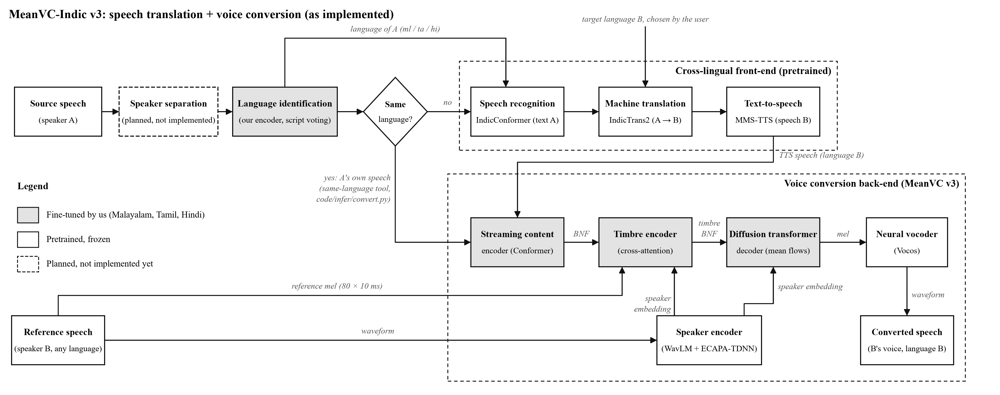

# MeanVC-Indic v3: system modules

**Speech translation + voice conversion between Malayalam, Tamil and Hindi**

This file describes every module in the architecture diagram, in the order the data flows through them.



For each module it gives:

| Field | Meaning |
|---|---|
| **Type** | fine-tuned by us / pretrained and frozen / planned |
| **Input** | what goes into the module |
| **Process** | what happens inside |
| **Output** | what comes out, and where it goes next |
| **Model** | the model file used |
| **Code** | where it is in the project |

**Running example used throughout:** speaker A says a 5-second sentence in Malayalam, the user chooses
Tamil as the target, and speaker B's recording gives the voice. The output is the sentence in Tamil,
spoken in B's voice. Sizes are given for that 5-second input (16 kHz audio = 80,000 samples).

---

## Overview

```
speaker A's speech
   -> [1] Source speech                (load, 16 kHz mono)
   -> [2] Speaker separation           (PLANNED, not implemented)
   -> [3] Language identification      (our encoder: which language?)
   -> [4] Same language? decision
         yes -> A's own speech goes straight to [8]   (separate tool convert.py)
         no  -> [5] Speech recognition  (IndicConformer: speech -> text A)
             -> [6] Machine translation (IndicTrans2:   text A -> text B)
             -> [7] Text-to-speech      (MMS-TTS:       text B -> speech, generic voice)
   -> [8] Streaming content encoder    (our encoder: speech -> BNF, "what is said")

speaker B's speech
   -> [9]  Reference speech            (load, 16 kHz mono)
   -> [10] Reference mel               ("how B sounds", frame by frame)
   -> [11] Speaker encoder             (WavLM + ECAPA: "who B is", one vector)

[8] + [10] + [11] -> [12] Timbre encoder        (content dressed in B's timbre)
[12] + [11]       -> [13] Diffusion transformer (generates the mel of the new speech)
[13]              -> [14] Neural vocoder        (mel -> waveform)
                  -> [15] Converted speech      (Tamil sentence, B's voice)
```

- **Words path:** A's speech → text → translated text → TTS speech → BNF
- **Voice path:** B's speech → reference mel + speaker embedding

The two paths meet only in the timbre encoder and the DiT. **A's voice never reaches the voice
converter, only A's words do.**

---

## [1] Source speech (speaker A)

| | |
|---|---|
| **Type** | Input |
| **Input** | A recording of speaker A in Malayalam, Tamil or Hindi: any file `soundfile` can read (wav, flac, …), any sample rate, mono or stereo. 3–15 s works best. |
| **Process** | Read the file as float32 samples. Stereo is averaged to mono. Resampled to 16,000 Hz with a polyphase filter (scipy `resample_poly`). Values clipped to the range −1 … +1. |
| **Output** | Waveform: 16,000 numbers per second (80,000 for 5 s), float32. → [3] language identification (and [8] on the same-language path) |
| **Code** | `load_wav()` in `code/infer/convert.py` |
| **Note** | The input must contain **one** speaker. Overlapping speakers are not handled yet (see [2]). |

## [2] Speaker separation (overlapping speech)

| | |
|---|---|
| **Type** | **Planned, not implemented** |
| **Input** | (planned) A recording where two or more people speak at the same time |
| **Process** | (planned) Split the mixture into one track per speaker, e.g. with a separation model, and pass the chosen speaker's track on. |
| **Output** | (planned) Speech of one speaker → [3] |
| **Status** | No code exists for this module. Today the waveform from [1] goes directly to [3]. |

## [3] Language identification

| | |
|---|---|
| **Type** | Fine-tuned by us (Stage 2) |
| **Input** | Speaker A's waveform (16 kHz) |
| **Model** | `checkpoints/encoder_v3/best.pt` (encoder + CTC head + attention decoder; the attention decoder is not used here) |
| **Code** | `Recognizer`, `identify_language()` in `code/translate/speech_translator.py` |
| **Result** | 99.3 % correct on 300 test clips (Malayalam 100, Tamil 100, Hindi 98). 0.05 s per clip. |

**Process:**
1. **Feature extraction:** Kaldi filter-bank (fbank) features, 80 frequency bands every 10 ms, scaled
   ×32768 (as in training). 5 s → 500 × 80.
2. **Our fine-tuned Fast-U2++ encoder:** conv2d subsampling (×4, to 40 ms frames), then 7 Conformer
   layers (dimension 256, 4 attention heads, streaming convolution that only looks at the past),
   processed in 200 ms chunks with 2 chunks of memory.
3. **CTC head:** for every 40 ms frame, a probability for each of the 174 tokens (Malayalam, Tamil and
   Devanagari letters, space `▁`, `<blank>`, `<unk>`, `<sos/eos>`).
4. **Greedy decoding:** take the most likely token per frame, merge repeats, remove `<blank>` and
   `<unk>`, turn `▁` into a space → a string of letters.
5. **Script voting:** every letter's Unicode name tells its script (MALAYALAM, TAMIL or DEVANAGARI).
   The script with the most letters is the language. Its share of all letters is the confidence.
6. If the confidence is below 60 %, the user is asked to confirm (command line).

**Output:** language code `ml` / `ta` / `hi`, confidence (e.g. 0.97), letters per script.
→ [4] the decision, and [5] (IndicConformer must be told the language). It also fixes the target menu:
only the other two languages are offered.

## [4] Same language? (decision)

| | |
|---|---|
| **Type** | Program logic |
| **Input** | Source language (from [3]) and the target language B chosen by the user (`--target ml/ta/hi/all`, or a menu that only lists the two other languages) |
| **Process** | Compare the two. |
| **Output** | **no** (different languages) → translate: [5] → [6] → [7] → [8]<br>**yes** (same language) → no translation: A's own speech goes to [8] |
| **Code** | `choose_targets()` in `speech_translator.py` (the translation tool refuses the same language and asks for a different one); the "yes" path is the separate same-language tool `code/infer/convert.py` |

## [5] Speech recognition (speech → text A)

| | |
|---|---|
| **Type** | Pretrained, frozen (AI4Bharat IndicConformer 600M, multilingual) |
| **Input** | Speaker A's waveform (16 kHz) + the language code from [3] |
| **Output** | Transcript: text in language A, e.g. a Malayalam sentence. → [6] |
| **Model** | `ai4bharat/indic-conformer-600m-multilingual` (ONNX + TorchScript files, `D:\hf_cache`) |
| **Code** | `IndicConformerRecognizer`, `keep_script()` in `speech_translator.py` |
| **Runs on** | CPU (ONNX Runtime), about 0.7 s per clip |
| **Result** | CER 7.3 % / WER 22.8 % on 300 test clips (our own encoder: 26.2 % CER). Options: `--asr ours` (the letters from [3]), `--asr mms` (Meta MMS-1b-all). |

**Process:**
1. **Preprocessor** (TorchScript): audio → log-mel features.
2. **Conformer encoder** (ONNX): features → acoustic representations per frame.
3. **RNNT decoding** (greedy): a prediction network (2-layer LSTM, 640 units) remembers the letters
   written so far; a joint network combines it with each encoder frame, and a **language-specific**
   output layer (here: Malayalam) picks the next letter, up to 10 letters per frame. `▁` becomes a space.
4. **`keep_script()`:** letters that came out in another script are transliterated into the source
   script, and an invalid virama after a Malayalam chillu letter is removed.

## [6] Machine translation (text A → text B)

| | |
|---|---|
| **Type** | Pretrained, frozen (AI4Bharat IndicTrans2 Indic-Indic, distilled, 320M) |
| **Input** | Text in language A + source and target language codes (e.g. `mal_Mlym` → `tam_Taml`) |
| **Output** | Translated text in language B, e.g. a Tamil sentence. → [7] |
| **Model** | `ai4bharat/indictrans2-indic-indic-dist-320M` (`D:\hf_cache`) |
| **Code** | `Translator` in `speech_translator.py`; `IndicProcessor` in `code/translate/indic_processor.py` (pure-Python copy; the official IndicTransToolkit does not install on Windows) |
| **Runs on** | GPU, about 0.9 s |
| **Result** | Translation agreement chrF 64.7 (vs the translation of the correct transcript) |

**Process:**
1. **Pre-processing (IndicProcessor):**
   - normalise punctuation, turn Indic digits into 0–9
   - replace numbers, e-mails and URLs by placeholders `<ID1>`, `<ID2>`, …
   - Indic normalisation and tokenisation
   - transliterate Malayalam / Tamil script into Devanagari (the model's shared script)
   - add the two language tags in front: `mal_Mlym tam_Taml <text>`
2. **Tokeniser:** text → subword token ids.
3. **Transformer encoder-decoder:** beam search with 5 beams. The output is limited to about twice the
   input length and may not repeat any 4-token sequence (prevents the model from looping on noisy text).
4. **Post-processing (IndicProcessor):** restore the placeholders, transliterate Devanagari back into the
   target script (Tamil), join tokens into normal text.

## [7] Text-to-speech (text B → speech B)

| | |
|---|---|
| **Type** | Pretrained, frozen (Meta MMS-TTS, one model per language) |
| **Input** | Translated text in language B |
| **Output** | Speech in language B, 16 kHz, in the TTS model's own **generic** voice (right words, wrong voice: 0.17 similarity to B). → [8] |
| **Model** | `facebook/mms-tts-mal`, `-tam`, `-hin` (`D:\hf_cache`) |
| **Code** | `Synthesizer` in `speech_translator.py` |
| **Runs on** | GPU, about 1.6 s |

**Process** (VITS, an end-to-end model):
1. **Tokeniser:** characters → ids (characters the voice does not know are dropped).
2. **Text encoder:** reads the character sequence.
3. **Duration predictor:** decides how long each sound lasts.
4. **Normalising flow + HiFi-GAN decoder:** produces the waveform directly.

A fixed random seed makes the same text always give the same audio. Loud peaks are scaled down to 0.95.

## [8] Streaming content encoder (speech → BNF, "what is said")

| | |
|---|---|
| **Type** | Fine-tuned by us (Stage 2) |
| **Input** | The speech whose **words** are kept: the TTS speech from [7] (translation path), or speaker A's own speech from [1] (same-language path) |
| **Output** | BNF: 256 numbers every 10 ms, shape (1, T, 256), "what is said". → [12] (5 s of speech: 125 frames of 40 ms → 500 frames of 10 ms) |
| **Model** | `checkpoints/encoder_v3/encoder_best.pt` (epoch 83) |
| **Code** | `VoiceConverter.content()` in `code/infer/convert.py` → `extract_bn()` in `code/decoder/extract_features.py`, `stretch_bn()` in `code/decoder/train_dit.py` |

**Process:**
1. **Kaldi fbank:** 80 bands every 10 ms.
2. **The same Conformer encoder as in [3]** (encoder part only), run exactly as in training and feature
   extraction:
   - slices of 200 ms (20 fbank frames, with a 23-frame window)
   - memory of the previous 2 slices (attention cache and convolution cache)
   - streaming convolution (past only)
3. **The encoder output is the BNF** (bottleneck features). Because the encoder was trained to recognise
   **letters** (CTC + attention loss), the BNF describes the sounds and words and carries little
   information about who is speaking.
4. **BNF frames (40 ms) are repeated ×4 to 10 ms**, to line up with the mel frames.

## [9] Reference speech (speaker B)

| | |
|---|---|
| **Type** | Input |
| **Input** | Any recording of speaker B, in any of the three languages (`--reference B.wav`). Without `--reference`, speaker A's own speech is used (same person, new language). 5–15 s works best: a longer reference gives a better copy of the voice. |
| **Process** | As in [1]: mono, 16 kHz, values in −1 … +1. |
| **Output** | B's waveform. → [10] reference mel, and [11] speaker encoder |
| **Code** | `load_wav()` in `convert.py`; `SpeechTranslator.voice()` in `speech_translator.py` |

## [10] Reference mel ("how B sounds", in detail)

| | |
|---|---|
| **Type** | Signal processing (MeanVC's own settings, no learning) |
| **Input** | B's waveform |
| **Process** | Mel spectrogram: short-time Fourier transform (FFT size 1024, window 640 samples = 40 ms, hop 160 samples = 10 ms), mapped onto 80 mel frequency bands. |
| **Output** | Reference mel ("prompt"): 80 numbers every 10 ms, shape (1, T_ref, 80). A 12 s reference gives 1,200 frames. It keeps the fine detail of B's timbre: how B's vowels and consonants actually sound. → [12] timbre encoder |
| **Code** | `MelSpectrogramFeatures` (`third_party/MeanVC/src/infer/infer_ref.py`), loaded by `load_mel_extractor()` in `extract_features.py`; used in `VoiceConverter.voice()` |

## [11] Speaker encoder ("who B is", one vector)

| | |
|---|---|
| **Type** | Pretrained, frozen (WavLM-Large + ECAPA-TDNN) |
| **Input** | B's waveform |
| **Process** | 1. **WavLM-Large**, a large self-supervised speech model, turns the audio into rich frame-level features.<br>2. **ECAPA-TDNN**, a speaker-verification network, combines all frames (attentive statistics pooling) into one fixed-size vector. |
| **Output** | Speaker embedding (x-vector): 256 numbers for the whole recording, shape (1, 256). It describes B's overall voice identity: pitch range, gender and vocal-tract shape. → [12] timbre encoder **and** [13] DiT |
| **Model** | `checkpoints/pretrained/wavlm_large_finetune.pth` |
| **Code** | `load_speaker_model()` in `extract_features.py`; `VoiceConverter.voice()` / `embed()` in `convert.py` |

The same model also **measures** the results: speaker similarity = cosine between two of these vectors
(output vs B, output vs A).

## [12] Timbre encoder (content dressed in B's timbre)

| | |
|---|---|
| **Type** | Fine-tuned by us (Stage 4, part of the DiT checkpoint) |
| **Input** | BNF from [8] (query: T × 256)<br>Reference mel from [10] (keys and values: T_ref × 80)<br>Speaker embedding from [11] (projected to 256 and joined to the keys) |
| **Output** | Timbre BNF: 256 numbers every 10 ms, shape (1, T, 256): what is said, coloured with B's timbre. → [13] |
| **Model** | `timbre_encoder` inside `checkpoints/dit_v3/dit_best.pt` |
| **Code** | `MRTE` in `third_party/MeanVC/src/model/prompt_vp.py`, called inside the DiT |

**Process** (MRTE, multi-reference timbre encoder: 2 cross-attention blocks, 4 heads):
- The speaker embedding is projected (linear layer 256 → 256), repeated for every reference frame, and
  joined to the reference mel, forming the **keys**.
- The reference mel frames are the **values**.
- Each BNF frame (**query**) "looks at" all reference frames and gathers the timbre detail that matches
  the sound it represents: how B would say this sound.
- Each block: attention + residual connection + layer normalisation + feed-forward.

## [13] Diffusion transformer decoder (generates the new speech, as a mel)

| | |
|---|---|
| **Type** | Fine-tuned by us (Stage 4) |
| **Input** | Timbre BNF from [12] (T × 256)<br>Speaker embedding from [11] (repeated for every frame)<br>Random noise in the shape of a mel (T × 80), the starting point<br>The already generated previous chunks (KV cache) |
| **Output** | Mel spectrogram of the converted speech: 80 numbers every 10 ms, shape (T, 80), values in −1 … +1. → [14] |
| **Model** | `checkpoints/dit_v3/dit_best.pt` (epoch 18, EMA weights), `config_200ms.json` |
| **Code** | `generate()` in `code/decoder/train_dit.py`; DiT with KV cache in `third_party/MeanVC/src/infer/dit_kvcache.py`; called in `VoiceConverter.convert()` |
| **Result** | Validation mel error 0.177 (0.260 for the original Mandarin model) |

**Process** (generation with **mean flows**, in only 2 steps):
1. Start from random noise shaped like a mel spectrogram.
2. For each step, the DiT predicts the average change (velocity) that moves the noise towards real
   speech over the time interval of that step. Two time embeddings (current time *t* and target time *r*)
   tell it which step it is on. Because it learned the **average** velocity of the whole interval,
   2 steps are enough (normal diffusion needs tens of steps).
3. Inside the network: the noisy mel, the timbre BNF and the speaker embedding are concatenated per frame
   and projected to 512 dimensions, then go through 4 transformer blocks (dimension 512, 2 heads, rotary
   positions).
4. **Streaming:** the speech is generated 200 ms (20 frames) at a time. A key-value cache keeps the
   earlier chunks, so each new chunk continues smoothly.

## [14] Neural vocoder (mel → waveform)

| | |
|---|---|
| **Type** | Pretrained, frozen (Vocos) |
| **Input** | Mel spectrogram from [13], rescaled from (−1 … +1) to (0 … 1), shape (1, 80, T) |
| **Process** | Vocos predicts, for every frame, the magnitude and the phase of the short-time spectrum (ConvNeXt network), then an inverse FFT turns them into audio samples. The vocoder is loaded fresh for every conversion (it breaks after a failed call, a lesson from v2). If the loudest sample exceeds 0.99, the whole clip is scaled down. |
| **Output** | Waveform, 16 kHz. → [15] |
| **Model** | `checkpoints/pretrained/vocos.pt` |
| **Code** | `VoiceConverter.convert()` in `convert.py` |

## [15] Converted speech (the result)

| | |
|---|---|
| **Type** | Output |
| **Input** | Waveform from [14] |
| **Process** | Saved as 16-bit PCM WAV, 16 kHz. Speaker similarity to B and to A is computed with the speaker encoder [11]. |
| **Output** | Speaker A's sentence, translated into language B, in speaker B's voice. |
| **Result** | (48 translations, test speakers never seen in training) sounds like B 0.733 (two real recordings of B: 0.754) · leakage of A 0.173 · intelligibility CER 9.5 % · DNSMOS 3.05 · 7.9 s for 7.7 s of speech on the laptop |

Files in `outputs/translate/<input>_to_<target>/`:

| File | Contents |
|---|---|
| `input.wav` | A's original speech |
| `reference.wav` | B's voice |
| `tts.wav` | The translation in the generic TTS voice (before conversion) |
| `output.wav` | **The result** |
| `result.json` | Language, confidence, transcript, translation, times, similarities |

---

## Data sizes for the 5-second example

| Data | Size |
|---|---|
| Waveform (A, TTS, output) | 80,000 samples (16 kHz) |
| fbank | 500 frames × 80 |
| CTC letters | 125 frames (one guess per 40 ms) |
| Text | One sentence of words |
| BNF | 125 × 256 (40 ms) → stretched to 500 × 256 (10 ms) |
| Reference mel (12 s of B) | 1,200 × 80 |
| Speaker embedding | 1 × 256 |
| Timbre BNF | 500 × 256 |
| Generated mel | 500 × 80 (generated in 25 chunks of 200 ms, 2 steps each) |

## Which parts we trained

| | Modules |
|---|---|
| **Fine-tuned by us** on Malayalam, Tamil, Hindi (IndicVoices-R, 30,000+ clips) | [3] language identification and [8] streaming content encoder: the same Fast-U2++ encoder (`code/encoder/train_encoder.py`)<br>[12] timbre encoder and [13] diffusion transformer: the MeanVC DiT (`code/decoder/train_dit.py`) |
| **Pretrained and frozen** | [5] IndicConformer, [6] IndicTrans2, [7] MMS-TTS, [10] mel settings, [11] WavLM + ECAPA, [14] Vocos |
| **Planned** | [2] speaker separation |
